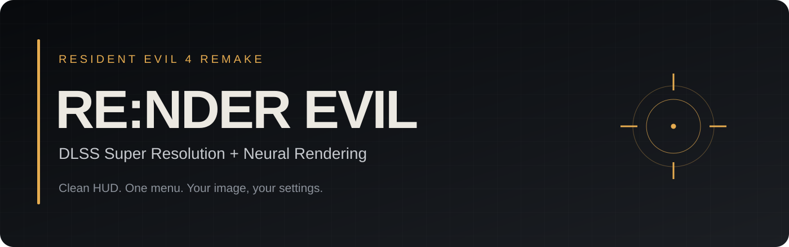
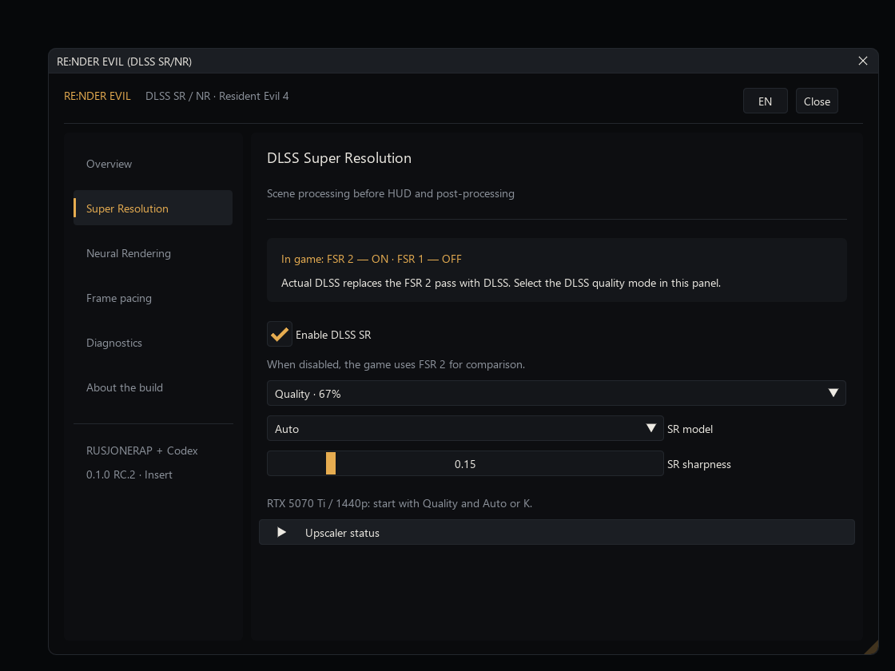
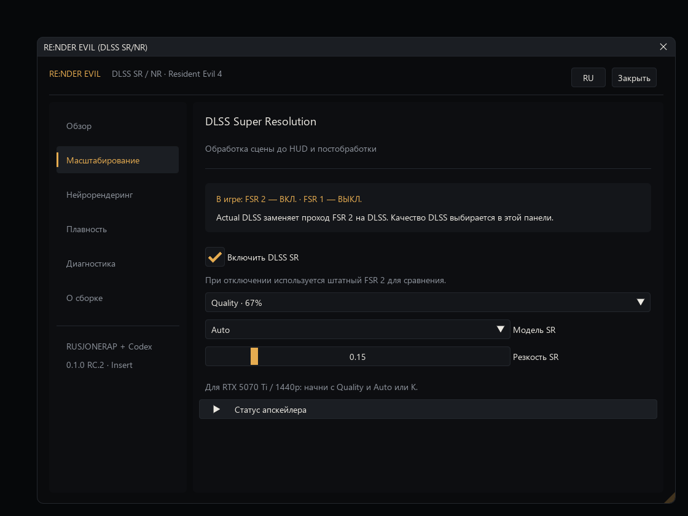
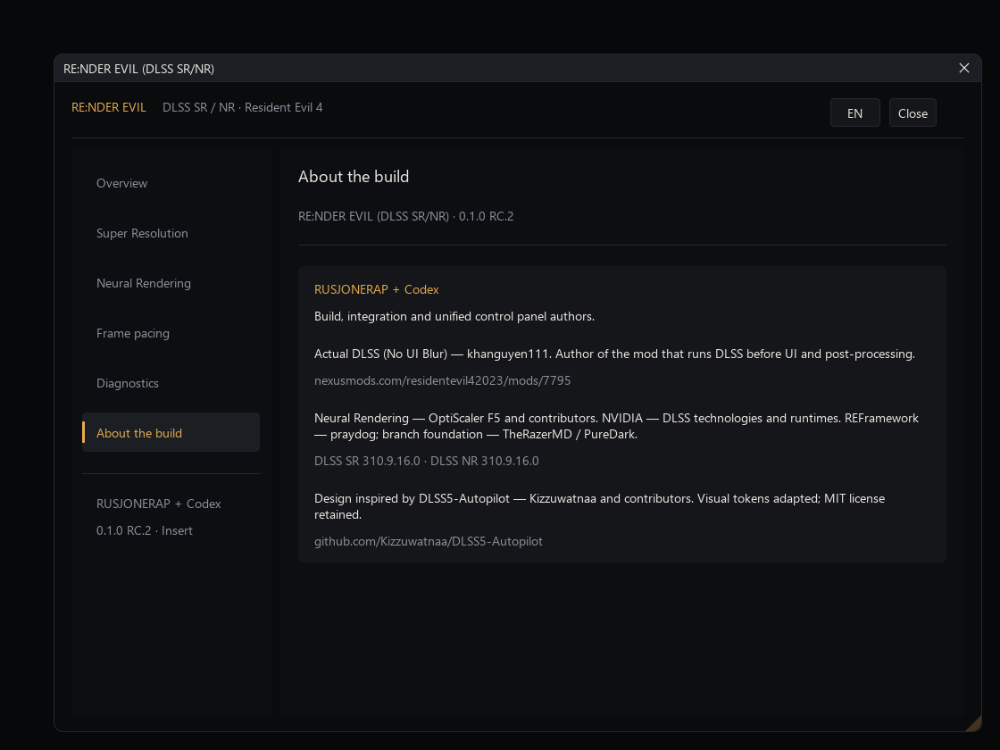

  
  
  

# RE:NDER EVIL (DLSS SR/NR)

**DLSS Super Resolution and DLSS 5 Neural Rendering for Resident Evil 4 Remake — with a clean HUD and one menu.**

Sharper scenes. Readable subtitles. A reticle that stays intact when you move the camera. RE:NDER EVIL brings Actual DLSS and OptiScaler F5 together in a single package, with independent SR and NR controls.

**[Download the full installer ZIP](https://github.com/RUSJONERAP/RENDER-EVIL-RE4-DLSS/releases/download/v0.1.0-rc.2/RENDER-EVIL-v0.1.0-rc.2-Full.zip)** · [Installation](#install-in-a-minute) · [Русская инструкция](docs/README_RU.md) · [Report a problem](https://github.com/RUSJONERAP/RENDER-EVIL-RE4-DLSS/issues/new/choose)

## What you get

| Feature | In the panel |
| --- | --- |
| NVIDIA DLSS Super Resolution | DLAA, Quality, Balanced, Performance, Ultra Performance |
| DLSS 5 Neural Rendering | Its own switch, model preset, intensity and working resolution |
| Clean interface | Both SR and NR run on the scene before the game's interface is composited |
| Your frame cap | Any target from 10 to 360 FPS, plus handy presets and a frame-time graph |
| One place for everything | **Insert** opens the English / Russian panel |
| A way back | Installer checks files and backs up the previous setup outside the game |

All required mod DLLs and both DLSS runtimes are in the release ZIP. **No separate mod downloads.** You still need the game and a compatible NVIDIA driver. Frame generation is not included.

## Why the HUD stays clear

Actual DLSS places Super Resolution at the game's native upscaling stage. Our integration keeps F5 Neural Rendering inside that same evaluation, so both passes finish before the game adds its interface. The tested route preserves readable menus, subtitles and the reticle while SR and NR process the scene.

**[Read the technical write-up: the before-HUD pipeline, compatibility bridge and GPU-lifetime fixes](docs/HUD_PIPELINE.md).**

## Install in a minute

1. Close RE4. Download **`RENDER-EVIL-v0.1.0-rc.2-Full.zip`** from [Releases](https://github.com/RUSJONERAP/RENDER-EVIL-RE4-DLSS/releases/tag/v0.1.0-rc.2) — not GitHub's automatic “Source code” ZIP.
2. Extract it to a folder outside the game. Run **`Install.cmd`**. It finds Steam libraries automatically; if needed, paste the folder containing `re4.exe`.
3. Launch RE4 and press **Insert**. Start with **Quality**. Enable Neural Rendering separately when you are happy with SR.

> **Keep FSR 2 ON and FSR 1 OFF in the game's settings.** Actual DLSS replaces that FSR 2 pass with DLSS. Choose your DLSS quality in the RE:NDER EVIL panel. The installer sets this up for you.

For a custom FPS cap, set the game's frame rate to **Variable**, then enable **Limit FPS** on the panel's **Frame pacing** page. Entering a number alone does not enable the cap.

To restore your previous setup, close RE4 and run **`Uninstall.cmd`** from the extracted package. Backups live in `%LOCALAPPDATA%\RENDER-EVIL\Backups`. The installer also prints the exact backup manifest path. Saves and `re4.exe` are not changed.

## Compatibility and current status

Validated against **RE4 Steam 1.5.9.0 on Windows 11**. See the [validation notes](docs/VALIDATION.md) for the test setup and coverage; other configurations are not verified. The installer checks the exact supported game executable and stops if it differs. It also rejects known injector conflicts; do not stack this package with PD Upscaler, another OptiScaler or a DXGI injector.

Checked scenarios include gameplay with SR + NR, menus and HUD, a DLC cutscene, a 70 FPS cap and exit through the game menu. Gameplay checks cover the RC.1 rendering path retained in RC.2; the updated panel and installer passed separate offline checks. See the [validation notes](docs/VALIDATION.md) for results.

- **Known issue:** Alt+F4 can show `Fatal D3D error 4 / E_ACCESSDENIED` at shutdown. **Exit through the game's menu** instead; that path passed the local test.
- Not every campaign cutscene has been tested. Auxiliary-view NR bypass is unit-tested; its activation in an actual cutscene still needs confirmation.
- This is a **release candidate**, not an official Capcom or NVIDIA integration. SR and NR runtimes are **310.9.16.0**; the included user-supplied NR DLL is unsigned.

## A look inside

*Actual panel rendered offscreen for documentation. This is a UI preview, not a gameplay or performance comparison.*

Russian panel and credits

## Built on good work

**Build, integration and panel: RUSJONERAP + Codex.**

- **[Actual DLSS (No UI Blur)](https://www.nexusmods.com/residentevil42023/mods/7795) — khanguyen111.** The before-HUD DLSS implementation; supplied DLL is unchanged.
- **[OptiScaler F5](https://github.com/janblade/OptiScaler-F5-DLSSNR-Multipass)** — OptiScaler developers and F5 contributors. Neural Rendering backend.
- **[REFramework](https://github.com/TheRazerMD/REFramework)** — praydog; branch foundation TheRazerMD / PureDark.
- **Design inspired by [DLSS5-Autopilot](https://github.com/Kizzuwatnaa/DLSS5-Autopilot) — Kizzuwatnaa and contributors.** MIT notice retained.
- **NVIDIA** — DLSS technology and runtimes.

Our integration changes use the MIT license. Third-party components keep their own terms; see [component notices](THIRD_PARTY.md). The included Actual DLSS DLL has upstream redistribution restrictions; inclusion does not grant additional rights or change its authorship.

Want to inspect or improve the integration? Start with [building from source](docs/BUILD_SOURCE.md) and the [source layout](source/README.md).
