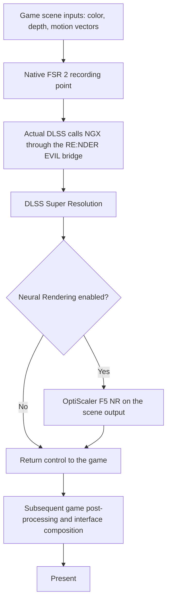

# Keeping the HUD outside Super Resolution and Neural Rendering

**RE:NDER EVIL runs both DLSS Super Resolution and Neural Rendering at the game's native upscaling stage, before the interface is composited.** The scene receives both passes; HUD text, menus, subtitles and the reticle are drawn later by the game on this integrated path.

Preserving that boundary was the main rendering-integration problem behind this project. This page explains the working route, the earlier experiments and the code that connects the components.

## The rendering boundary

The integrated path uses **Actual DLSS (No UI Blur), by khanguyen111**, to replace the game's native FSR 2 pass. Its author describes the integration as running before the UI and post-processing. RE:NDER EVIL routes that plugin's NGX calls through OptiScaler F5 so that NR can execute inside the same upscaler call. [Actual DLSS project page](https://www.nexusmods.com/residentevil42023/mods/7795).



This diagram shows the integration boundary. The game controls the detailed ordering of its downstream post-processing and UI passes.

The essential distinction is between **NR after SR** and **NR after the final composed frame**. In this build, “after SR” means that NR runs immediately after the upscaler inside the NGX evaluation, while the game has yet to add its interface. This preserves the clean scene/UI separation for both components.

## Why the first approach damaged the interface

The earlier TemporalUpscaler route produced blurred menu transitions, damaged unselected text and a reticle that could partially disappear during fast camera movement. Several control checks narrowed the problem down:

| Check | Result and implication |
| --- | --- |
| Disable NR, leave the old upscaler enabled | The text defect remained. NR was not required to reproduce it. |
| Disable TemporalUpscaler | The menu became clean. |
| Use the game's native FSR 2 path | The interface stayed clean, providing a useful reference for the integration point. |
| Temporarily bypass the old upscaler in menus | Menus improved, but this switched rendering paths and did not solve the gameplay HUD boundary. |

We investigated game state, render layers, shader variants and the native FSR 2 resource contract, including a RenderDoc GPU capture. That work identified the right direction, but the experimental native replacement was not a finished HUD-safe renderer.

Actual DLSS already provided the working native-pass integration. We adopted it and focused our changes on making that route cooperate with F5 NR. **The native before-HUD SR implementation belongs to khanguyen111.**

The current route keeps SR active through the tested menus. The earlier menu bypass and PD backend are disabled in the dedicated build.

## Connecting Actual DLSS to F5

Actual DLSS normally resolves the NVIDIA NGX driver core itself. Our adapter redirects its NGX loading requests to the existing OptiScaler provider in the game directory.

The adapter is scoped to the loaded `re4dlss.dll` module. It finds that module's named `LoadLibraryExW` and `GetProcAddress` imports and changes their in-memory import-table entries. Other library names keep their original loader behavior. The driver-core filenames `_nvngx.dll` and `nvngx.dll` resolve to the already loaded game-local provider, with a matching module reference for the caller's eventual `FreeLibrary`.

The procedure adapter wraps NGX feature creation, evaluation, release and shutdown. The underlying Actual DLSS and NVIDIA DLL files remain unchanged on disk.

This gives the scene pass one route:

```text
Actual DLSS's native game hook
  -> NGX compatibility adapter
  -> OptiScaler's upscaler evaluation
  -> NVIDIA SR
  -> F5 NR, when enabled
  -> return to Actual DLSS and the game
```

See [`ActualOptiBridge.hpp`](../source/REFramework-overlay/src/mods/ActualOptiBridge.hpp), especially `load`, `procedure`, `evaluate_feature` and `attach`. The framework integration call sites are included in [`REFramework.patch`](../source/REFramework.patch).

## Keeping NR on the scene path

The shipped configuration selects:

```ini
[DlssNr]
Placement=evaluate
RunBeforeSR=false
```

In F5's D3D12 NGX input code, the upscaler's successful evaluation is followed by `EvaluateAfterUpscale` on the same command list. This is the point at which NR consumes the scene output. The corresponding source is included in the full release's `source/OptiScaler-fde33d31.zip`; relevant files are:

- `OptiScaler/inputs/NVNGX_DLSS_Dx12.cpp`
- `OptiScaler/dlssnr/DlssNrFeature_Dx12.h`
- `OptiScaler/shaders/dlssnr/DlssNr_Dx12.cpp`

`Placement=evaluate` keeps NR attached to the upscaler evaluation. Selecting a Present-based NR route changes this architecture and falls outside the before-HUD setup described here.

SR and NR have separate controls. NR can be disabled while SR stays active. A standalone NR route with the Actual DLSS upscaler disabled is outside this setup's validation.

## Resource lifetime mattered too

Moving both passes to the right stage was only part of the integration. The first combined revision also hit a GPU hang with NR disabled, so enabling NR alone could not explain that failure.

The revised adapter handles NGX feature retirement explicitly:

1. A release request retires the original opaque handle without immediately destroying its provider context.
2. A fence is signalled on the game's actual DIRECT queue after Present.
3. The provider receives the deferred release once that fence has completed.
4. Create, Evaluate and provider Release operations share a recursive mutex, serializing access to F5's context map.
5. Shutdown stops late retirement callbacks before provider contexts are destroyed.

The implementation preserves the original handle pointer. It uses GPU completion rather than a fixed number of elapsed frames to decide when to release resources. A standalone D3D12 WARP test held a handle through 64 blocked presents, then released it exactly once after fence completion.

Present callbacks handle fence retirement and frame pacing. NR rendering stays in the upscaler evaluation path.

Source: [`UnifiedGpuLifetime.hpp`](../source/REFramework-overlay/src/mods/UnifiedGpuLifetime.hpp), [`UnifiedRetirement.hpp`](../source/REFramework-overlay/src/mods/UnifiedRetirement.hpp) and [`unified_gpu_test.cpp`](../source/tests/unified_gpu_test.cpp). These changes address a concrete lifetime hazard; they do not establish a diagnosis for every possible GPU hang.

## Settings without constant reconfiguration

The companion [`unified_native.lua`](../source/unified_native.lua) sends explicit quality requests to `via.render.UpscalingInterface`. A request is acknowledged once; the script does not continually force the selected quality mode back onto the game. Changing the panel language does not request a new SR configuration.

**FSR 2 must remain ON and FSR 1 OFF in the game's settings.** That selects the native engine pass Actual DLSS replaces. DLSS quality is chosen in the RE:NDER EVIL panel.

## What has been checked

The tested rendering path covers gameplay with SR + NR enabled, menus and HUD, camera movement, a DLC cutscene and normal menu exit. The interface remained clear in the tested scenes. One session completed 28,943 NR frames with zero model failures; an earlier GPU-lifetime revision exceeded 115,000 frames. See the [validation notes](VALIDATION.md) for the test setup and results.

These results support the before-HUD integration for the tested game build and configuration. They do not constitute an audit of every UI element, campaign scene or third-party injector combination. Native UI effects and downstream game post-processing still apply normally.

Two limits remain separate from the HUD result:

- Auxiliary-view NR bypass is implemented and unit-tested; its activation in a real cutscene has not yet been observed.
- Alt+F4 can still produce an E_ACCESSDENIED shutdown error. Normal exit through the game menu passed the recorded check.

## Credits

**Actual DLSS / native before-HUD SR:** khanguyen111. **Neural Rendering backend:** OptiScaler F5 contributors and NVIDIA runtimes. **Compatibility adapter, GPU-lifetime handling, quality-command integration and unified panel:** RUSJONERAP + Codex, built on REFramework. Component terms remain listed in [THIRD_PARTY.md](../THIRD_PARTY.md).
